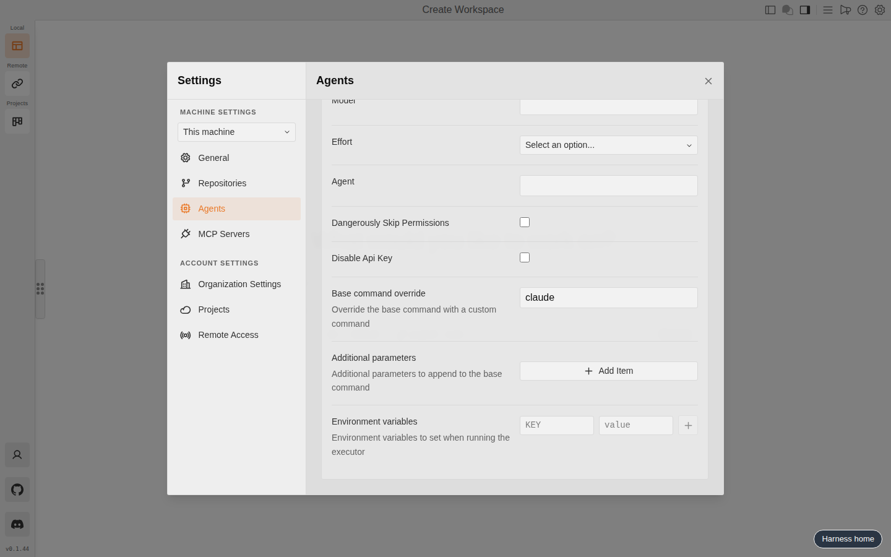
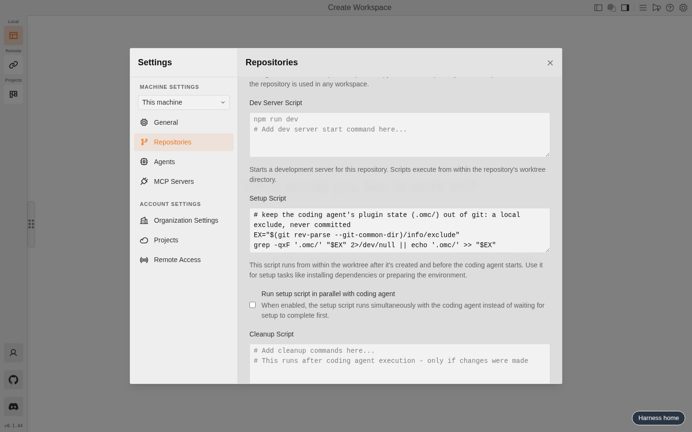
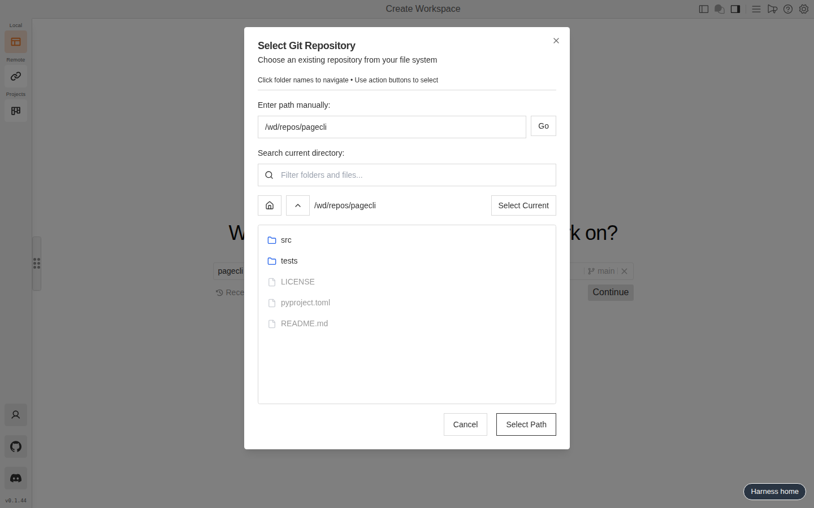
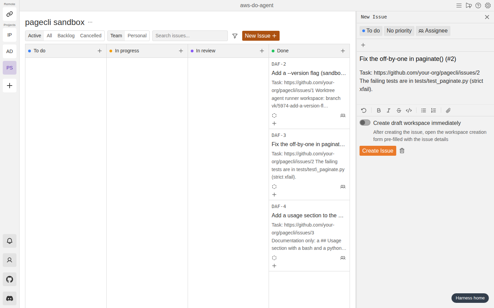
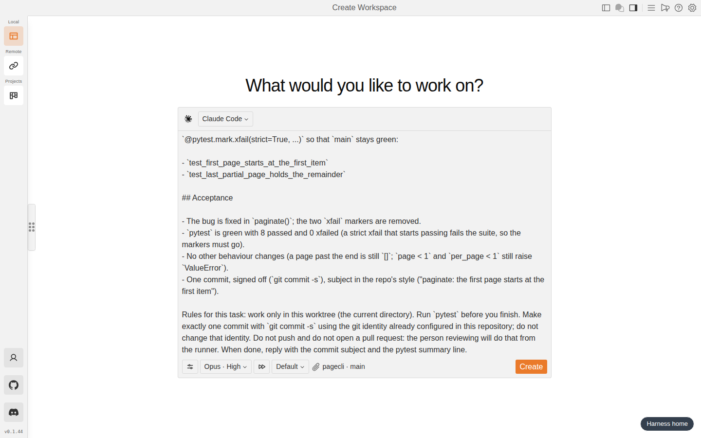
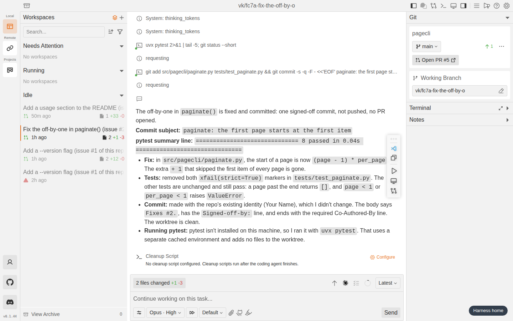
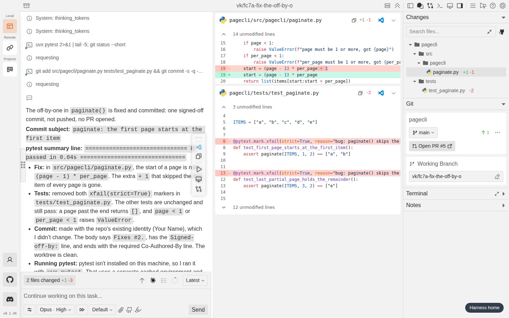
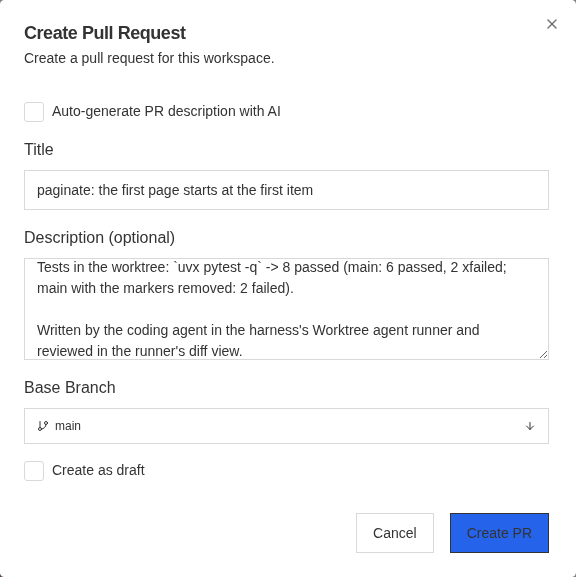
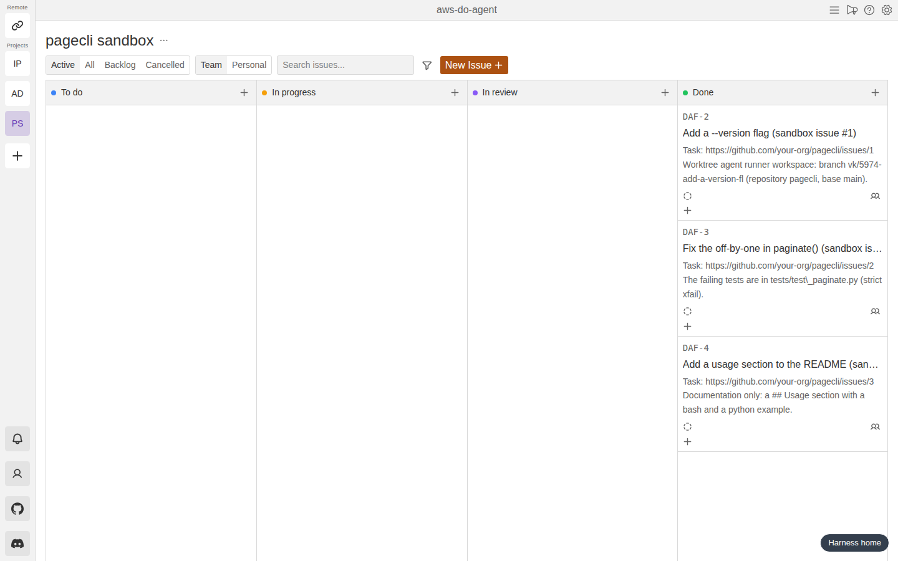

# Coding through the kanban board and the agent runner

The harness's home page has two task surfaces. The **Goals board** is a self-hosted vibe-kanban board (docs/manual/boards.md
"Kanban board"); the autonomy loop mirrors its goals there, and you can keep your own cards on it. The **Worktree
agent runner** is vibe-kanban's workspaces view: for each task it creates a git worktree on a branch of its own,
runs a coding agent (Claude Code, on the same Amazon Bedrock access as the agent's terminal) in it, shows you the
diff, and opens the pull request. This guide takes one small repository through three tasks with them - a feature
with a test, a bug fix against a failing test, and a documentation change - from the home page to a reviewed pull
request, and ends with the checklist that says whether the workflow worked.

Everything below was run in a browser against a fresh deployment, and the times are from that run. The run
differed from the text in five ways, none of which changes a step:
* the deployment used its own container names and home port, so it would not collide with others on the host;
* the host gave the container an empty AWS and kube configuration: Bedrock access came from the instance role;
* the first task ran before the setup script of step 3 existed;
* from the third task's move to Done on, the browser ran in a network namespace of its own, like a browser at the
  far end of the SSH tunnel (see "Troubleshooting");
* the screenshots were retaken after the run, with the account and repository names replaced by placeholders.

* [What you need](#what-you-need)
* [Setup, once per deployment](#setup-once-per-deployment)
* [The walkthrough: three tasks](#the-walkthrough-three-tasks)
* [How pull requests are created and reviewed](#how-pull-requests-are-created-and-reviewed)
* [Evaluation checklist](#evaluation-checklist)
* [Troubleshooting](#troubleshooting)

## What you need

* **The harness, running.** `./run.sh` with the default `.env`, and the home page at `http://localhost:8000/`
  through an SSH tunnel (`ssh -L 8000:localhost:8000 <host>`). The board and the runner are on by default
  (`UI_VIBE_KANBAN=true`).
* **Bedrock access for the agent.** The runner's Claude Code uses the container's AWS credentials, exactly like the
  agent's terminal (docs/manual/aws.md "AWS credentials"): an instance role, or the passed-through environment.
* **A GitHub token in the container.** Export `GH_TOKEN` or `GITHUB_TOKEN` in the host shell before `./run.sh`
  (docs/manual/memory.md "A GitHub token"). The runner pushes the branch with `git` and opens the pull request with `gh`, and
  both use that token, so the pull request's author is the token's account. A coding agent can also use the token,
  with whatever scopes it has. For a controlled environment, use a fine-grained token limited to the one
  repository you work on, with read and write access to its contents and pull requests.
* **A repository to work on.** It needs a test suite the agent can run. The walkthrough used a tiny Python
  command-line tool with a pytest suite and three issues. The tool prints one page of a list. The issues are: add a
  `--version` flag with a test; fix an off-by-one in `paginate()`, with the failing tests already in the suite as
  strict `xfail`; and add a usage section to the README.

## Setup, once per deployment

Check these four things before the first task. The first is the walkthrough's one step outside a page: the
runner registers repositories by their path inside the container and cannot clone a URL.

1. **Clone the repository in the container.** Open the **tmux terminal** tile and open a shell window beside the
   agent's session (`Ctrl-b c`). Then run:

   ```bash
   gh auth setup-git                                   # git uses the container's GitHub token
   gh repo clone <owner>/<repo> /wd/repos/<repo>       # /wd is the persisted volume
   git -C /wd/repos/<repo> config user.name  "<your name>"
   git -C /wd/repos/<repo> config user.email "<your e-mail>"
   ```

   The agent's commits use this repository identity. According to the runner's source, it sets an identity of
   its own only when the repository has none.

2. **The agent runner's Claude Code profile.** Open the **Agent workspaces** tile, then the gear (Settings),
   then **Agents**, then **Claude Code**, configuration **Default**. Check two fields and Save:
   * **Base command override** is `claude`, the image's Claude Code. The runner's own default command runs
     Claude Code through `npx`, and the image does not put `npx` on the runner's `PATH`, so without this field
     every start fails (see "Troubleshooting").
   * **Dangerously Skip Permissions** is not ticked. vibe-kanban ticks it by default. Unticked, the agent runs in
     Claude Code's default permission mode: the run log shows `permissionMode=auto`, and the **tmux terminal**
     tile's Claude Code shows "auto mode on". In this mode each tool call is checked before it runs. All four agent
     runs of the walkthrough worked in it, with no permission denials.

   

3. **Keep the agent's plugin state out of git.** The image's Claude Code plugins write their state into the
   working directory, in `.omc/`. With `VK_RUNNER_AUTO_COMMIT=true` in `.env.local`, the runner commits what a run left
   uncommitted, so without this step that state lands on your branch (see "How pull requests are created and
   reviewed"). In the runner's Settings, open **Repositories**, pick the repository, and set its **Setup Script**,
   which runs in every new worktree before the agent starts:

   ```bash
   # keep the coding agent's plugin state (.omc/) out of git: a local exclude, never committed
   EX="$(git rev-parse --git-common-dir)/info/exclude"
   grep -qxF '.omc/' "$EX" 2>/dev/null || echo '.omc/' >> "$EX"
   ```

   

4. **Register the repository and create a project.**
   * Runner: on "Which repositories would you like to work on?", choose **Browse**. Enter `/wd/repos/<repo>`,
     then **Go** and **Select Current**. The repository is now under **Recent**. Pick it, pick the branch
     (`main`), and **Continue**: the runner remembers both for the next workspace.
   * Board: open the **Goals board** tile and create a project with the **+** in the left bar. A project you
     create is yours; the loop mirrors its goals only into the project named after the container.

   

## The walkthrough: three tasks

Each task goes through the same five steps. Between them, the board's card shows where the task is.

1. **Card.** On the board, choose **New Issue** in your project. Write a title, and a description with the link
   to the task (the issue), then **Create Issue**. The card shows at once. It is saved when it gets its number, a
   prefix and a count (`DAF-2`, `DAF-3`, ... here). In the walkthrough a new card took 20 to 30 seconds to save;
   see "Troubleshooting".

   

2. **Attempt.** In the runner, paste the task's text into "What would you like to work on?". The repository and
   branch are under the box, and the agent and model are on its toolbar. Choose **Create**. The runner creates
   the branch `vk/<id>-<task>` and its worktree, runs the setup script, and starts Claude Code with your text as
   the prompt. Move the card to **In progress** (its status chip, top left of the card).

   

   Say in the task text what done means: which tests must pass, how many commits, and what not to do. Each task
   of the walkthrough was its issue's text followed by these rules (the third task also carried the leak test's
   planted values, VKC-5):

   > Rules for this task: work only in this worktree (the current directory). Run `pytest` before you finish. Make
   > exactly one commit with `git commit -s` using the git identity already configured in this repository; do not
   > change that identity. Do not push and do not open a pull request: the person reviewing will do that from the
   > runner. When done, reply with the commit subject and the pytest summary line.

3. **Review.** The workspace page shows the agent's conversation: each tool call, and its final answer. **N files
   changed** opens the diff, file by file. The Git panel on the right shows how many commits the branch is ahead
   of `main`. To ask for a change, type it in the box under the conversation and choose **Send**: the agent
   continues in the same worktree and session. Move the card to **In review**.

   

   

4. **Pull request.** In the Git panel, choose **Open pull request**. The dialog offers a title (the prompt's first
   line plus " (vibe-kanban)"), a description (the prompt), the base branch, and "Create as draft". It also has
   **Auto-generate PR description with AI**, ticked by default. The runner's settings describe it this way: "the
   AI agent will automatically update the PR title and description after creation". The walkthrough unticked it
   and wrote its own title and description each time. Then choose **Create PR**. The runner pushes the branch and opens the pull request. When it is done,
   the button reads **Open PR #N**.

   

5. **Card done.** Move the card to **Done** and comment with the pull request's link. In this walkthrough the
   cards and the workspaces were created separately, and nothing moved a card for a workspace: the moves were by
   hand. The card's "Link pull request" icon opened nothing on this self-hosted board. The New Issue form's
   "Create draft workspace immediately" toggle was not tried. The loop's mirror (`kanban-sync.py`) moves only the
   cards of the goals file.

   

What the three tasks took. An agent run is the runner's coding-agent process, from its start to its end:

| task | agent run | its commit | tests in the worktree | pull request | card |
|---|---|---|---|---|---|
| `--version` flag with a test | 92 s, 8 tool calls; one review follow-up, 36 s | `cli: the --version flag`, 2 files, +12 | 7 passed, 2 xfailed (main: 6 passed, 2 xfailed) | 1 commit, 2 files | created after the run, then Done, with a comment |
| the `paginate()` off-by-one | 109 s, 7 tool calls | `paginate: the first page starts at the first item`, 2 files, +1 -3 | 8 passed (main without the two `xfail` markers: 2 failed) | 1 commit, 2 files | To do, In progress, Done, with a comment |
| a README usage section | 74 s, 6 tool calls | `README: a usage section`, 1 file, +33 | 6 passed, 2 xfailed (documentation only; `main` has no `## Usage` section) | 1 commit, 1 file | To do, In progress, In review, Done, with a comment |

In the third task the agent noticed that the second task's fix was not on `main` yet. Its README shows the
intended output and adds a note on what the current code prints until that fix is merged; the review is where a
person decides whether that note belongs.

The first task ran before the setup script of step 3 existed. Its branch had a second commit, the runner's commit
of `.omc/`, and one review follow-up removed it. The text of that follow-up is under "Troubleshooting".

## How pull requests are created and reviewed

* **Who is who.** The pull request is opened by the account of the container's GitHub token. Each commit is
  authored by the repository's git identity (setup step 1). The agent signs off its commits when the task says so.
  Claude Code also added a `Co-Authored-By` trailer that names the model to every commit, which Claude Code's
  attribution settings can turn off.
* **What the runner does at the end of a run.** Two things happen when the agent stops:
  * The runner's **commit reminder** shows the agent its `git status` and asks it to commit. It is in Settings,
    General, Commits ("Commit reminder"), and it was ticked on this deployment.
  * If files are still not committed, they stay in the workspace. The runner's own automatic commit, which commits
    them with the agent's last answer as the commit message, is off (`VK_RUNNER_AUTO_COMMIT`, docs/manual/install.md "Git
    identity"). In the walkthrough's first run, before it was off, the agent declined to commit the plugin
    state and said why, and the runner then committed it anyway. Always check the commit count in the Git panel
    before **Open pull request**.
* **Review where you like.** The runner's diff view is the first review. After **Create PR**, the pull request is
  on GitHub like any other, with its checks and reviewers; the runner's Git panel links to it. To change the
  branch after that, send a follow-up in the same workspace and push the branch again; the walkthrough did not
  need to.
* **What stays local.** A workspace's worktree is in `/var/tmp/vibe-kanban/worktrees` inside the container, and a
  new container does not have it. The runner checks it out again from the workspace's branch, so anything not
  committed is lost with the old container (docs/manual/boards.md "Kanban board", "Asked once").

## Evaluation checklist

These checks say whether coding through the board and the runner works on a deployment. Each one is falsifiable:
its failing control removes the property, and the check must then FAIL. The last column is the walkthrough's
result.

| # | criterion | check id | how it is checked | failing control | result in the walkthrough |
|---|---|---|---|---|---|
| VKC-1 | a workspace is created from the repository within 5 minutes of choosing **Create** | VKC-1 | the runner's `GET /api/workspaces` lists it with its branch, and the coding-agent run has started, within 300 s of the click | the runner's stock Claude Code profile (no base command): the start answers 500 and the agent run fails at once. The check is that the run started and did not fail | PASS 3 of 3: the agent run started 1 to 13 s after the click. Control FAIL: 500, `ExecutableNotFound { program: "npx" }`, and the run failed |
| VKC-2 | the attempt produces a commit whose tests pass in the worktree | VKC-2 | the branch is ahead of `main` by the task's commits, signed off, and the suite run in the worktree passes with the task's expected counts | the same checks on `main`: the new test is missing (task 1), the fixed tests fail once their `xfail` markers are removed (task 2), the README has no `## Usage` section (task 3) | PASS 3 of 3. Controls FAIL as expected: task 1's test is absent on `main` (6 passed); task 2's tests fail on `main` (2 failed); `main`'s README has no `## Usage` |
| VKC-3 | a pull request exists on the repository, opened by the token's account, with the diff | VKC-3 | `gh api repos/<owner>/<repo>/pulls/<n>`: `user.login` is the token's account and `changed_files` is at least 1; every entry of `/pulls/<n>/commits` has `author.login` set to that account | a workspace branch with no pull request (the failed first attempt), and the check run for another account: both fail | PASS 3 of 3. Both controls FAIL |
| VKC-4 | the card reflects the attempt: its column and a link to the pull request | VKC-4 | the board's `GET /v1/issues?project_id=<id>` has the card in Done, and its comments (`GET /v1/issue_comments?issue_id=<id>`) or description carry the pull request's URL | a card not in Done (the loop's goal card), and a card in Done checked for another pull request's link: both fail | PASS 3 of 3, after moving the cards by hand. Nothing links a card to a workspace automatically. Both controls FAIL |
| VKC-5 | a credential-shaped string the agent saw never reaches the board, the UIs' logs or the loop's state | VKC-5 | three planted fake credentials (a GitHub token shape, an `aws_secret_access_key` assignment, a bearer token) in the task text and in a loop fire's transcript, mirrored by `/agent/kanban-sync.py`: none is in any card, comment or description, or under `/wd/ui`, `/wd/loop` or `/wd/kanban`. Search for each value's random part as well: the runner stores the token shape with its underscore escaped (`ghp\_`), which a literal search misses | an earlier `kanban-sync.py` that masks only token shapes and secret-named settings: the AWS key and the bearer token reach the board | PASS within that scope: the only board hit is the control's own comment. Outside it, the task text is kept as typed in the runner's database and session logs, Claude Code's transcripts, claude-mem's store and the LogLearner index (see "Troubleshooting") |
| VKC-6 | during the attempts the container reaches nothing beyond the model endpoint, the instance metadata service, the git host and the package index the agent used | VKC-6 | the DNS answers and outbound TCP connections in the agent container's network namespace, captured for the whole run, each destination attributed by the name it was looked up under. The capture covers every process in the container, not only the runner | the runner's **Enable Telemetry** ticked for 25 s, with its analytics host blocked for the test: the runner looks that host up and the check fails | FAIL: claude-mem's telemetry reached PostHog throughout the run: between the agent runs, and once inside the third. On default settings, the runner's error reports reached its Sentry twice (at the failed first start, and at a database error during the second task's start), and a third time in the control. The third task's capture also has `gh` looking up its telemetry collector. The runner's own analytics stayed off. About 30 connections of the first two tasks are not attributed: that capture recorded no DNS (see "Troubleshooting") |
| VKC-7 | the workflow is reachable from the home page with no step outside a page | VKC-7 | every step of the walkthrough is a click or typing in a tile's page; a step that needs a shell is listed | a home page without the runner's tile: six steps lose their entry point. The same steps without the shell step PASS, so the check can pass | FAIL: one shell step remains, cloning the repository (setup step 1). The runner cannot clone a URL |

## Troubleshooting

* **"An internal error occurred. Please try again." when you choose Create.** The runner's log
  (`/wd/ui/vibe-kanban.log`) has `ExecutableNotFound { program: "npx" }`, and every start since the container
  started logs `Failed to discover Claude Code options`. The workspace and its branch exist, but no agent ran.
  Check setup step 2, then choose **Create** again.
* **The card spins, or the dialog says "Failed to fetch".** The board keeps one long-running request open for
  every live list on the page, and the browser allows six connections per host over plain HTTP. A save can wait
  for a free connection: in the walkthrough, saves took 20 to 75 seconds. Wait for the card's number, or the
  change, before you close the tab. A browser running on the Docker host itself also sees every container's
  network interface come and go, and Chromium aborts the requests in flight each time ("Failed to fetch"). A
  browser at the far end of the SSH tunnel does not see those changes.
* **A project stays on "Loading..." after you switch to it in the left bar.** Same cause. Reload the page, or open
  the project in a new tab.
* **Plugin state (`.omc/`) in the diff, or a second commit you did not ask for.** Check setup step 3. To clean a
  branch the runner already committed to, send a follow-up like the one the walkthrough used:

  > Add the line `.omc/` to this repository's local exclude file, "$(git rev-parse --git-common-dir)/info/exclude"
  > (not .gitignore, and do not commit it). Drop the runner's commit and keep yours: `git reset --soft HEAD~1`,
  > then `git rm -r --cached -f -q .omc` (with `--cached`, `-f` changes only the index; the plugin rewrites its files,
  > so without `-f` the command refuses). Check that `git status --porcelain` prints nothing and that `git log
  > --oneline main..HEAD` shows only your commit, run the tests again, and do not push.

* **Never put a credential in a task's text.** The board's mirror masks credential shapes before it posts a loop
  fire's transcript (VKC-5), but a task's text is not on that path. The runner keeps the text as you typed it, in
  its database and session logs. The agent's Claude Code keeps it in its transcripts. claude-mem and the LogLearner
  index keep it too, and both are on home-page tiles, so the text shows up there. Give the agent a secret through
  the environment or a file outside the repository, never in the prompt.
* **What the container talks to during an attempt** (VKC-6). The capture covers every process in the container,
  and only the third task's part of it recorded names, so the first two tasks are attributed by address.
  * **Named in the capture:** Amazon Bedrock (`bedrock-runtime` and `bedrock` in the region), the instance metadata
    service for the instance role, GitHub (`git`, `gh`, and the GitHub plugin's MCP server at
    `api.githubcopilot.com`), and the Python package index when the agent runs `uvx pytest`.
  * **Three more senders, on by default:**
    * the claude-mem plugin's anonymous telemetry, to PostHog (`us.i.posthog.com`);
    * `gh`'s telemetry collector, `cafe.github.com`. Its lookup is captured. Its address is shared with the MCP
      server, so a connection to it cannot be told apart;
    * the runner's error reports, to its Sentry project, matched by address. The runner's source compiles the
      Sentry project into the release binary ahead of any environment setting, so it has no off switch (read, not
      tested).
  * **Not attributed:** about 30 connections of the first two tasks. One of them goes to the address
    `api.anthropic.com` and `claude.ai` resolve to.

  claude-mem and `gh` both document `DO_NOT_TRACK=1` as their off switch. On the docker target, append
  `-e DO_NOT_TRACK=1` to `RUN_OPTS` in `.env` and restart (not verified in this run). The runner's own analytics are
  off by default (docs/manual/boards.md "Kanban board"), and the run confirmed it.
* **`Open pull request` fails because `gh` is not signed in.** The runner's source names this error
  `cli_not_logged_in`; it was not reproduced here. The container has no GitHub token: export one before
  `./run.sh` (see "What you need").
* **An agent run stops at a deletion.** Claude Code checks deleting commands (`rm`, `find -delete`, `rmdir`,
  `git clean`, a `mv` that overwrites) whose path is built from a variable that could be empty, and can hold such
  a command for a person's answer, which a headless run cannot give. That has been seen on other sessions on this
  harness, though no run of this walkthrough hit it. The runner's Claude Code profile also has an **Approvals**
  option, which was not tried here; it may let you answer such a prompt from the workspace page. Write deletions so they can be checked as written: literal
  paths, or every variable a path is built from guarded, for example `rm -rf "${WORK:?}/${name:?}"`. Put the same
  rule in your task text if the task deletes files.
